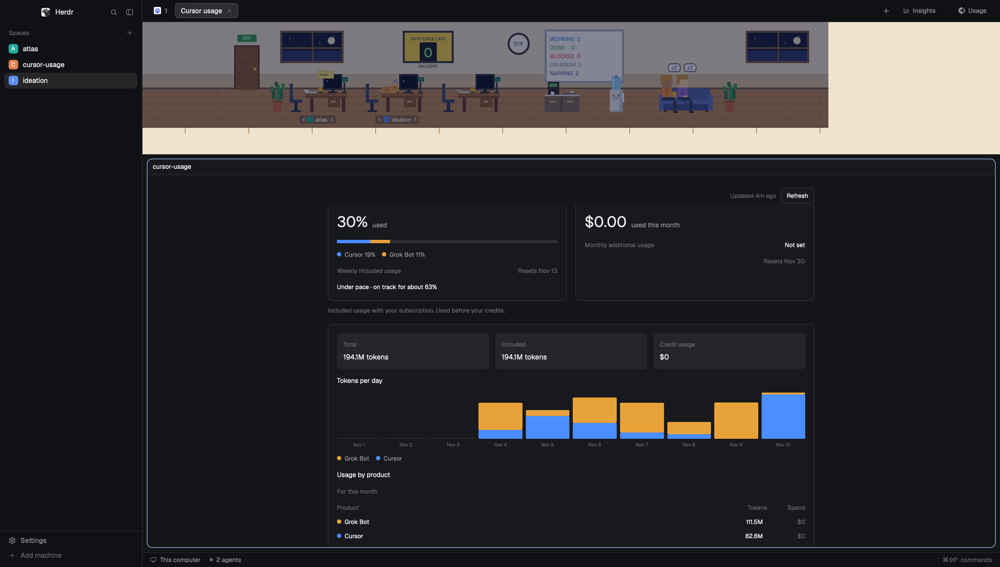

# Cursor usage

A **Usage** button in the tab strip opens one dashboard of the Cursor quota already signed in on this Mac: the weekly included percent split by product, this month's balance, tokens per day, and a year of AI line edits. This is a piece you add to the current layout, not a whole window.



This file is the brief: enough to build Cursor usage from an empty folder. The files next to it are one build of it. If they don't work on your Herdr, or you want it different, build it again from here.

## What you see

- **Toolbar button.** An 88px block on the right of the tab strip, chrome background, 1px bottom border in the border color. Inside it, a 26px row, 8px horizontal padding, 5px gap, radius 6: the Cursor mark at 15px (a cube with the pointer cut out, tinted with the text color) and the word **Usage** at 12px in the muted color. Hover uses the theme hover background and the foreground text.
- **Dashboard.** The pane is the theme canvas. One column, max width 920, padding 24, or 16 when the pane is narrower than 620. Cards are surface, 1px border, radius 8, padding 16, with 12px inside a card and 16px between cards. Text is foreground; secondary lines are dim or muted. There is no page title.
- **Header,** right-aligned above the cards. Dim 11.5px status: `Updated just now`, `Updated 4m ago`, `Refreshing…`, or the error in the blocked color. An outline **Refresh** button, 30px tall, radius 6, 11.5px medium.
- **Weekly row,** when Cursor returns weekly included usage. Two cards side by side, gap 16, each at least 280px wide; they wrap when the column is narrow.
  - **Included.** The plan name at 11.5px dim (`Premium`). The percent at 28px semibold (`30%`) with `used` at 12.5px muted. A 6px rounded track in the border color, filled left to right by product: Cursor `#4c8dff`, Grok Bot and Grok `#e8a23a`, API and Other `#8b9bb4`. An 8px dot and `Cursor 19%` for each product, 11.5px muted. Under that, `Weekly included usage` on the left and `Resets Nov 13` on the right, both 11.5px dim. The pace sentence is 11.5px foreground, or the blocked color when this pace runs out before reset.
  - **Balance.** `Account balance` at 11.5px dim. `$0.00` at 28px semibold with `used this month` at 12.5px muted. `Monthly additional usage` on the left and `Not set` (or a dollar limit) on the right. `Resets Nov 30` at the right, 11.5px dim.
- **Footnote,** 11.5px dim, under that row: `Included usage with your subscription. Used before your credits.`
- **Tokens,** when the month has daily points. Three tiles on the raised color, radius 8, padding 12, min width 120: `Total` / `194.1M tokens`, `Included` / `194.1M tokens`, `Credit usage` / `$0`. Then `Tokens per day` at 12.5px medium. A row of columns, 88px tall, stacked with Grok Bot on top of Cursor; a day with nothing is a 1px border line. Day labels are 9px (`Nov 4`). Every day is labeled when the month so far has 14 days or fewer; otherwise the 1st, every 5th, and the last day. A product legend, then `Usage by product` and `For this month.` A table: `Product`, `Tokens` (88px, right), `Spend` (72px, right), most tokens first.
- **Line edits,** when Cursor returns daily metrics, or one local day of suggested lines if it does not. The title is `AI line edits`, `Tab completions`, or `Agent lines of code`, 11.5px dim, with the total at 28px semibold. On the right, `All` / `Tab` / `Agent`: 22px tall, radius 6, the selected one on the card color with a border, the others on the raised color. A year of 10px squares, radius 2, 3px apart, Sunday-start UTC weeks ending today. Empty days use the border color. Days with edits use `#1a3f66`, `#245b96`, `#3b82f6`, `#8eb6ff` from least to most. Month names sit above the first week of that month, 9px dim. Four cells: `MOST ACTIVE MONTH`, `MOST ACTIVE DAY`, `LONGEST STREAK`, `CURRENT STREAK`. A `Less` / `More` scale. When a recent commit has a percent, a dim line: `Last commit 80% AI-generated`.
- **Other plans.** With no weekly included usage, one hero card instead of the weekly row. An uppercase 9.5px label: `INCLUDED THIS WEEK`, `INCLUDED THIS MONTH`, `INCLUDED USAGE`, `SPEND THIS CYCLE`, `ON-DEMAND USAGE`, or `INCLUDED REQUESTS`. The value is 28px (`20%`, `$82`, or `120 / 500`). An 8px track, filled in foreground, with a 1px tick at how far the cycle has elapsed. Dim reset text (`Resets Tue, Nov 18, 4:00 PM · 3d 12h · 23% per day still open`) and the pace sentence. The plan, email, and `on this Mac since Jan 2026` sit on the right of the label, 11.5px dim, truncated. A second card shows `AUTO`, `API`, and `TOKENS` when those numbers exist.
- **Empty and error.** No data yet: one card, an 8px accent dot, `Loading Cursor usage`, and `Reading the Cursor login on this Mac.` A failure with nothing to show uses the blocked color on the border and dot, title `Cursor usage is unavailable`, the error as the body, and a primary **Retry** button.

## How it behaves

- The toolbar click focuses a Cursor usage pane already open in the active space. If another pane on that tab is zoomed, it zooms that one back first. Otherwise it runs `tab.new` with name `Cursor usage` and mod `cursor-usage`.
- The dashboard reads on show, then every 5 minutes, and when Refresh or Retry is clicked. A read already in flight is left alone. The toolbar button does not read.
- Hovering the button changes its background. Hovering a token column or a line-edit square shows a tooltip (`Nov 6 · Grok Bot 12.4M · Cursor 8.1M`, or `Nov 6 · 318 lines`, or `Nov 2 · No tokens`). All, Tab, and Agent only change which series the heatmap counts. Nothing else moves. There are no agent-status colors.
- One meter, in this order:
  - Weekly included usage, when `usage-status` says the week is metered and has a budget. The headline percent is the used cents over the budget, floored. Anything above 0 and below 1 shows as `1`. Product percents are that integer split by each product's cents, largest remainder first, then listed largest percent first.
  - Otherwise included usage from the current period (`totalPercentUsed`, else `autoPercentUsed`).
  - Otherwise team or usage-based spend for the signed-in email.
  - Otherwise included requests from `GET /api/usage` (`gpt-4` is the aggregate).
- Pace is the only number the mod calculates. It waits until 10% of the window has passed. Under 0.95 is `Under pace · on track for about 63%`. Under 1.2 is `On pace`. At 1.2 or above is `Ahead of pace · about 2d before reset`, in the blocked color. `Used up` is the blocked color too. A high projection by itself does not change the color.
- A failed refresh keeps the last cards and puts the message beside Refresh. The first failure, with nothing to show, replaces the page with the error card.
- Missing sign-in says `No access token — sign in to Cursor`. A denied Keychain prompt says `Keychain access to Cursor Safe Storage was denied — allow it, then Refresh`. A missing Cursor database says `Cursor DB not found`.

## Built from

- **One mod**, `mods/cursor-usage/`. `mod.json` is `{ "place": "none", "title": "Cursor usage" }`. The same view draws the toolbar when `props.mode` is `"toolbar"`, and returns before any fetch. There is no `layouts/` folder and no `keys.json`.
- **Files:** `main.js` (the view), `ui.js` (the card, button, and type scale), `cursor.svg` (the mark, `fill-rule="evenodd"` so the pointer is a hole), `cursor_usage.py` (the collector).
- **To show the button,** clone the layout that is on screen and add one block beside its single `tabs` mod. If that tabs block is not already in a row, turn it into a non-resizable row and keep the old tabs content in a weight-1 child:

  ```json
  { "id": "cursor-usage-toolbar-button", "type": "block", "size": { "px": 88 },
    "content": { "mod": "cursor-usage", "props": { "mode": "toolbar" } } }
  ```

  `python3 scripts/install.py` does that on a clone and records the file hashes. `python3 scripts/uninstall.py` switches back and deletes the clone only when that clone was not edited afterward.
- **`herdr`:** `appHome`, `exec`, `panes`, `props`, `run`, `settings`, `spaces`, `theme`. Commands: `tab.new`, `pane.focus`, `pane.zoom`. Colors come from `theme()`. The column padding uses `settings().zoom`.
- **Program:** `python3 mods/cursor-usage/cursor_usage.py`, timeout 90 seconds. If `python3` cannot be started, the same script runs through the login shell. The script uses Python's `sqlite3`, `security`, and `curl`. It prints one JSON object and exits 0 even on a Cursor error.
- **What it reads.** Cursor's `state.vscdb` ItemTable and, when the token is sealed, the Keychain item **Cursor Safe Storage**. It then calls only `https://www.cursor.com`: `GET /api/usage`, `GET /api/auth/stripe`, `GET /api/dashboard/v2/usage-status?scope=user`, and POST `get-current-period-usage`, `get-plan-info`, `get-team-spend`, `get-user-analytics`, and `v2/query-daily-usage`. The cookie jar is mode `0600` and is deleted when the request finishes. The token is not printed.
- **Line edits.** `all` and `agent` are accepted lines added plus deleted. `tab` is accepted completions, a count, not lines. The heatmap colors only days the API returned. If analytics is empty, one local fallback uses `tabSuggestedLines` and `composerSuggestedLines` from `aiCodeTracking.dailyStats.v1.5.YYYY-MM-DD`. The token chart is the dashboard API, not the local database.

## Watch out

- macOS only. The first live fetch can prompt for Keychain access. Allowing it always lets `/usr/bin/security` read **Cursor Safe Storage** later. The mod reaches the network, runs programs, and reads files outside its folder. Say so before adding it.
- `"place": "none"` means Herdr will not show it until a layout adds the toolbar block. Shipped layouts are read-only. Do not edit a layout another installer owns: Insights records a hash of `office-insights.json`, and changing that file makes its uninstall refuse.
- Do not invent a product split when weekly included usage is absent. Fall back to the single hero. Do not draw empty days the API did not return, except the token chart, which fills each UTC day from the month's start through today.
- The email is on the report and on the fallback hero. The weekly cards do not print it.
- `herdr-app check` renders the loading card. It does not call Cursor or open the Keychain. A check writes `jsconfig.json` and `gpui-kit.d.ts` into the mod folder; those are generated and are not part of the mod.
- The token columns are a vertical stack, Grok Bot first. Absolute left and right did not stretch the segments. Chaining `.children()` after `.child()` replaces the earlier children, so build one children array.
- The SVG hole depends on `fill-rule="evenodd"`. A solid cube is not the Cursor mark.

## Done when

- `python3 -m unittest tests/cursor_usage_test.py tests/layout_test.py` passes.
- `herdr-app check mods/cursor-usage` passes.
- `python3 scripts/install.py` leaves the previous layout file byte-for-byte unchanged, shows **Usage** with the Cursor mark, and opens a dashboard of this Mac's own numbers.
- Refresh runs again. A missing token shows `No access token — sign in to Cursor` and Retry.
- `python3 scripts/uninstall.py` returns to the previous layout and removes `mods/cursor-usage`. Installing a second time works.
